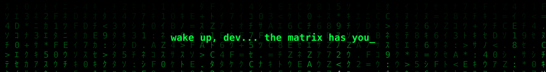

<p align="center"></p>

<p align="center"></p>

```text
renan@pires:~$ cat sobre_mim.txt

  Graduando em Engenharia de Software pela UNDB e estagiário de
  desenvolvimento na Defensoria Pública do Maranhão. Construo soluções
  digitais que unem automação, integração de sistemas e boas
  experiências de uso.

  Meu diferencial está na ponte entre design e tecnologia: transformo
  fluxos complexos em interfaces claras e soluções que fazem sentido
  para quem usa.
```

```text
renan@pires:~$ ls ./stack

  frontend/   HTML5  CSS3  JavaScript  TypeScript  React  Next.js
  backend/    Node.js  Python
  data/       PostgreSQL  Supabase
  automacao/  n8n  APIs REST
  design/     Figma
```

```text
renan@pires:~$ cat experiencia.log

  [*] Estagiário de Desenvolvimento · Defensoria Pública-MA
      Sistemas internos, automação de processos com n8n e integrações via API.

  [*] Desenvolvedor de Automações e Sistemas
      Integrações, painéis web, automações e bancos PostgreSQL/Supabase.

  [*] UI/UX & Desenvolvimento · Software House UNDB
      Prototipagem no Figma, construção de interfaces e times ágeis.
```

```text
renan@pires:~$ ps aux | grep atualmente

  > Automatizando fluxos e conectando sistemas por meio de APIs.
  > Construindo aplicações web com foco em clareza e experiência.
  > Evoluindo em arquitetura de software, banco de dados e produto.
```

```text
renan@pires:~$ cat principios.md

  01  Produto antes de ferramenta   tecnologia boa resolve problema real
  02  Design com propósito          interface intuitiva é qualidade técnica
  03  Automação com impacto         processos melhores liberam tempo
  04  Aprendizado contínuo          cada entrega é chance de evoluir
```

```text
renan@pires:~$ echo $CONTATO

  Aberto a conversar sobre software, automação e produtos digitais.
```

[LinkedIn](https://www.linkedin.com/in/renansilvapires/) · [Email](mailto:rspgameplay@gmail.com) · [GitHub](https://github.com/rspgameplay-ui)

<p align="center"></p>
